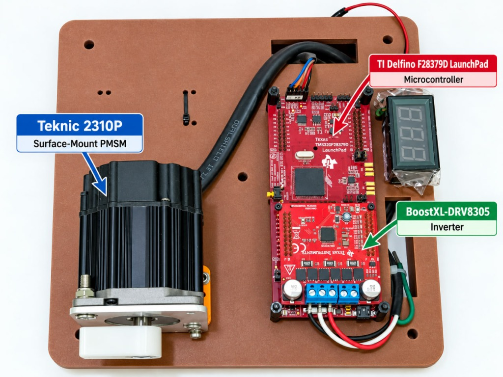
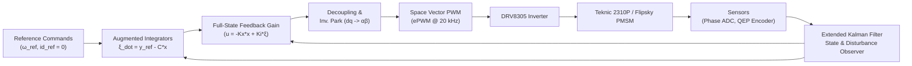

# PMSM Adaptive Control & Energy Optimization

[](https://www.mathworks.com/products/matlab.html)
[](https://www.mathworks.com/products/motor-control.html)
[](https://www.ti.com/tool/LAUNCHXL-F28379D)
[](https://www.ti.com/tool/BOOSTXL-DRV8305EVM)
[](https://www.teknic.com/)
[](LICENSE)

An advanced model-based design and embedded implementation repository for **Permanent Magnet Synchronous Motor (PMSM)** drives. This project focuses on **Full-State Feedback (FSFB)** control with integral action, **Extended Kalman Filter (EKF)** state and disturbance estimation, and **Energy Optimization** for vehicular traction and precision electric drive applications.

The algorithms are validated through extensive Simulink simulations and deployed directly to a high-performance **Texas Instruments C2000™ Delfino™ TMS320F28379D LaunchPad** paired with a **BOOSTXL-DRV8305 3-Phase Inverter** driving a **Teknic 2310P** surface-mount PMSM.

---

## 📷 Hardware Testbed

<p align="center">
  
</p>

The experimental hardware testbed integrates the following industrial-grade components:

| Component | Part / Model | Role & Specifications |
| :--- | :--- | :--- |
| **Microcontroller (MCU)** | [TI LAUNCHXL-F28379D](https://www.ti.com/tool/LAUNCHXL-F28379D) | Dual-core 32-bit C28x DSP @ 200 MHz with dual CLA coprocessors, 16-bit/12-bit high-speed ADCs, high-resolution PWMs (ePWM), and Enhanced Quadrature Encoder Pulse (eQEP) interface. |
| **Inverter BoosterPack** | [TI BOOSTXL-DRV8305](https://www.ti.com/tool/BOOSTXL-DRV8305EVM) | 3-phase gate driver supporting 4.4 V to 45 V DC bus, 15 A continuous current, three integrated low-side current shunt amplifiers, and SPI interface for gain/fault management. |
| **Electric Motor** | [Teknic Hudson M-2310P-LN-04K](https://www.teknic.com/) | 8-pole surface-mount permanent magnet synchronous motor (PMSM), rated 24 V – 48 V DC, rated speed up to 6000 RPM, with integrated optical quadrature encoder (1000 lines / 4000 CPR). |
| **Secondary Motor Target** | Flipsky 6374 (Outrunner PMSM) | 8-pole, 48 V DC traction motor evaluated for heavy-duty electric vehicle and tractor drive-cycle energy optimization. |
| **Sensors & Telemetry** | Shunt resistors + eQEP + SCI / UART | Fast 20 kHz synchronous phase-current measurement, optical encoder feedback, and real-time host-PC serial telemetry at 12 Mbps / 115200 baud. |

---

## 🚀 Key Features

- **Full-State Feedback (FSFB) Control**:
  - Replaces traditional multi-loop cascaded PI controllers with an optimal state-space architecture.
  - Direct calculation of $v_d$ and $v_q$ control voltages mapped into the Inverse Park transformation.
  - Augmented system integration for zero steady-state tracking error under parameter variations and load disturbances.
  - Built-in anti-windup protection for current and speed integrator states.

- **Extended Kalman Filter (EKF) State & Disturbance Observer**:
  - 4-state estimation vector: $\mathbf{x}_e = \begin{bmatrix} i_d & i_q & \omega_m & T_L \end{bmatrix}^T$.
  - Continuous-discrete filtering for high-fidelity rotor speed estimation and dynamic load-torque disturbance rejection.
  - Covariance tuning for sensor noise mitigation on ADC current measurements.

- **Field-Oriented Control (FOC) & Cross-Coupling Decoupling**:
  - Direct-quadrature ($dq0$) rotating reference frame formulation.
  - Feedforward cross-coupling compensation ($-\omega_e L_q i_q$ and $\omega_e L_d i_d + \omega_e \lambda_m$) to linearize d- and q-axis plants.

- **Energy Optimization & Traction Drive Cycles**:
  - Loss-minimizing current trajectories ($i_d = 0$ control and Maximum Torque Per Ampere - MTPA).
  - Dedicated simulation model for agricultural electric tractor drive cycles (`tractor_energy_optimization.slx`).

- **Embedded Deployment with Embedded Coder**:
  - Autocoded C/C++ firmware targeting TI C2000 DSP hardware.
  - Hard real-time execution inside ADC/PWM interrupt service routine (ISR) at $20\text{ kHz}$ ($T_s = 50\,\mu\text{s}$).
  - Real-time parameter tuning and bidirectional scope telemetry via Simulink Host Model (`mcb_pmsm_SIUnit_host_model.slx`).

---

## 🧠 Control Architecture & Formulation



### 1. PMSM State-Space Formulation
In the rotor-aligned $dq$ synchronous reference frame, the continuous-time non-linear PMSM plant dynamics are:

$$\begin{aligned}
\frac{di_d}{dt} &= -\frac{R_s}{L_d} i_d + \omega_e \frac{L_q}{L_d} i_q + \frac{1}{L_d} v_d \\
\frac{di_q}{dt} &= -\omega_e \frac{L_d}{L_q} i_d - \frac{R_s}{L_q} i_q - \frac{P \lambda_m}{2 L_q} \omega_m + \frac{1}{L_q} v_q \\
\frac{d\omega_m}{dt} &= \frac{3 P \lambda_m}{4 J} i_q - \frac{B_v}{J} \omega_m - \frac{1}{J} T_L
\end{aligned}$$

For a surface-mount PMSM ($L_d = L_q = L$), decoupled state matrices with state $\mathbf{x} = \begin{bmatrix} i_d & i_q & \omega_m \end{bmatrix}^T$ and input $\mathbf{u} = \begin{bmatrix} v_d & v_q \end{bmatrix}^T$ are:

$$\mathbf{A} = \begin{bmatrix} -\frac{R_s}{L} & 0 & 0 \\ 0 & -\frac{R_s}{L} & -\frac{P \lambda_m}{2 L} \\ 0 & \frac{3 P \lambda_m}{4 J} & -\frac{B_v}{J} \end{bmatrix}, \quad \mathbf{B} = \begin{bmatrix} \frac{1}{L} & 0 \\ 0 & \frac{1}{L} \\ 0 & 0 \end{bmatrix}, \quad \mathbf{C} = \begin{bmatrix} 1 & 0 & 0 \\ 0 & 0 & 1 \end{bmatrix}$$

### 2. Augmented Integral Servo Design
To guarantee zero steady-state tracking error for d-axis current and rotor speed, the system is augmented with integral states $\boldsymbol{\xi}$:

$$\dot{\boldsymbol{\xi}} = \mathbf{y}_r - \mathbf{C}\mathbf{x} = \begin{bmatrix} i_{d,\text{ref}} - i_d \\ \omega_{m,\text{ref}} - \omega_m \end{bmatrix}$$

$$\mathbf{A}_i = \begin{bmatrix} \mathbf{A} & \mathbf{0}_{3 \times 2} \\ -\mathbf{C} & \mathbf{0}_{2 \times 2} \end{bmatrix}, \quad \mathbf{B}_i = \begin{bmatrix} \mathbf{B} \\ \mathbf{0}_{2 \times 2} \end{bmatrix}$$

Feedback gain matrix $\mathbf{K} = \begin{bmatrix} \mathbf{K}_x & -\mathbf{K}_i \end{bmatrix}$ is computed via robust pole placement (`place(Ai, Bi, desired_poles)`), setting the closed-loop poles according to the physical frequency bandwidth:
- Current loop bandwidth: $\omega_{c,i} \approx 2\pi \times 800\text{ rad/s}$
- Speed loop bandwidth: $\omega_{c,s} \approx 2\pi \times 60\text{ rad/s}$
- Integral servo pole: $\omega_{c,\xi} \approx 2\pi \times 90\text{ rad/s}$

---

## 📊 Motor Specifications

| Parameter | Symbol | Teknic M-2310P | Flipsky 6374 | Unit |
| :--- | :--- | :--- | :--- | :--- |
| **Rated DC Bus Voltage** | $V_{dc}$ | 24 | 48 | $\text{V}$ |
| **Stator Resistance** | $R_s$ | 0.3819 | 0.72 | $\Omega$ |
| **d-axis Inductance** | $L_d$ | 0.20 | 0.40 | $\text{mH}$ |
| **q-axis Inductance** | $L_q$ | 0.20 | 0.40 | $\text{mH}$ |
| **Permanent Magnet Flux** | $\lambda_m$ | 0.01273 | 0.0426 | $\text{Wb}$ |
| **Number of Poles** | $P$ | 8 (4 pairs) | 8 (4 pairs) | - |
| **Rotor Inertia** | $J$ | $7.061 \times 10^{-6}$ | $3.618 \times 10^{-4}$ | $\text{kg}\cdot\text{m}^2$ |
| **Viscous Damping** | $B_v$ | $2.636 \times 10^{-6}$ | $9.444 \times 10^{-5}$ | $\text{N}\cdot\text{m}\cdot\text{s/rad}$ |
| **Rated Speed** | $\omega_{\text{rated}}$ | 6000 (~628 rad/s) | 2865 (~300 rad/s) | $\text{RPM}$ |
| **Rated / Peak Current** | $I_{\text{rated}} / I_{\text{max}}$ | 2.8 / 4.0 | 10.0 / 15.0 | $\text{A}$ |
| **Encoder Resolution** | $N_{\text{cpr}}$ | 4000 (1000 lines $\times$ 4) | Sensorless / Hall | $\text{counts/rev}$ |

---

## 📁 Repository Structure

```
PMSM_adaptive_control/
├── docs/
│   └── images/
│       └── hardware_testbed.jpg              # Annotated hardware testbed photograph
├── slide/
│   └── Hardware.pptx                         # Pinouts, wiring diagrams, and testbed slides
│
├── mcb_pmsm_foc_qep_f28379d_SIUnit_data.m    # Parameter & gain setup for FOC/FSFB baseline model
├── mcb_pmsm_fsfb_f28379d_param.m             # Augmented state-space pole placement & gain solver
├── replace_pid_with_fsfb.m                   # Automation script replacing PI controllers with FSFB
├── inspect_input_scaling.m                   # Unit test & validation of ADC/QEP scaling blocks
│
├── v1_0_3_sim_param_fsfc.m                   # Simulation parameters with EKF 4-state observer
├── v1_0_3_sim_fsfc.slx                       # Full simulation model with EKF + FSFB
├── v0_pmsm_fsfb_sim_for_flipsky.slx          # Simulation model tuned for Flipsky 6374 motor
├── v0_pmsm_fsfb_sim_for_flipsky_.m           # Parameter script for Flipsky 6374 simulation
├── tractor_energy_optimization.slx           # Electric tractor traction drive & energy optimization
│
├── mcb_pmsm_foc_qep_f28379d_SIUnit.slx       # Hardware deployment model for TI F28379D + DRV8305
├── mcb_pmsm_fsfb_qep_f28379d.slx             # Target model with Full-State Feedback deployed to MCU
├── mcb_pmsm_SIUnit_host_model.slx            # PC Host Model for real-time telemetry & calibration
│
├── mcb_pmsm_foc_qep_f28379d_SIUnit_ert_rtw/  # Generated C/C++ Embedded Coder code & CCS project
├── testing_ert_rtw/                          # Target real-time test build artifacts
├── CONTRIBUTING.md                           # Developer & contribution guidelines
├── LICENSE                                   # MIT Open-Source License
└── README.md                                 # Project documentation
```

---

## 🛠️ Getting Started

### Prerequisites
- **MATLAB & Simulink** (R2022b or R2024a recommended)
- **Toolboxes**:
  - Motor Control Blockset™
  - Embedded Coder®
  - Control System Toolbox™
  - Simulink Coder™
  - Embedded Coder Support Package for Texas Instruments C2000™ Processors
  - Texas Instruments Code Composer Studio (CCS) v11+ with C2000 compiler tools

---

### 1. Running Simulations (MIL / SIL)

To simulate the state-feedback controller with the Extended Kalman Filter in Simulink:

1. Open MATLAB and set your current working directory to this repository.
2. Load the simulation parameters:
   ```matlab
   run('v1_0_3_sim_param_fsfc.m')
   ```
   *(This initializes motor matrices $\mathbf{A}, \mathbf{B}, \mathbf{C}$, pole placement gains $\mathbf{K}$, and EKF covariance matrices $\mathbf{Q}_d, \mathbf{R}_d, \mathbf{P}_0$.)*
3. Open the simulation model:
   ```matlab
   open_system('v1_0_3_sim_fsfc.slx')
   ```
4. Run the simulation and open the scopes to observe current tracking ($i_d, i_q$), speed tracking ($\omega_m$), and estimated load torque ($T_L$).

For electric tractor drive-cycle energy optimization, execute:
```matlab
open_system('tractor_energy_optimization.slx')
```

---

### 2. Hardware Deployment to TI Delfino TMS320F28379D

#### Step A: Hardware Wiring & Pin Connections
1. Connect the **BOOSTXL-DRV8305** inverter into **BoosterPack Site 1** (J1-J4) on the **LAUNCHXL-F28379D**.
2. Connect the **Teknic 2310P** 3-phase power leads to inverter terminals `A`, `B`, `C`.
3. Connect the motor's optical encoder cable to the **eQEP1** header on the LaunchPad (`QEPA`, `QEPB`, `QEPI`, `5V`, `GND`).
4. Connect a regulated DC power supply ($24\text{ V}$, current limit set to $3\text{ A}$ for initial tests) to the DRV8305 power terminals.
5. Plug the micro-USB cable from the LaunchPad to your PC.

#### Step B: Parameter Initialization
1. In MATLAB, run the hardware parameter script:
   ```matlab
   run('mcb_pmsm_foc_qep_f28379d_SIUnit_data.m')
   ```
2. Verify that `pmsm.PositionOffset` matches your motor's QEP alignment angle (default: `0.1665`).
3. Set your target COM port:
   ```matlab
   target.comport = 'COM3'; % Adjust to your device COM port in Windows Device Manager
   ```

#### Step C: Build & Flash
1. Open the deployment model:
   ```matlab
   open_system('mcb_pmsm_foc_qep_f28379d_SIUnit.slx')
   % Or the FSFB variant:
   % open_system('mcb_pmsm_fsfb_qep_f28379d.slx')
   ```
2. Press **Ctrl + B** (or click **Build, Deploy & Start** in the Hardware tab).
3. Simulink compiles the model via Embedded Coder and flashes the binary (`.out`) onto the TMS320F28379D flash memory.

#### Step D: Real-Time Host Monitoring
1. Open the host monitoring interface:
   ```matlab
   open_system('mcb_pmsm_SIUnit_host_model.slx')
   ```
2. Configure the serial port block to match your LaunchPad virtual COM port.
3. Click **Run** on the host model.
4. Interact with the live dashboard to:
   - Toggle Motor Start/Stop.
   - Inject speed steps and position profiles.
   - Monitor real-time rotor speed, phase currents, and $dq$ voltages.

---

## 🔬 Mathematical Reference & Bibliography

1. **Texas Instruments**, *BOOSTXL-DRV8305EVM User's Guide*, Literature Number: [SLVUAI8A](https://www.ti.com/lit/ug/slvuai8a/slvuai8a.pdf).
2. **Texas Instruments**, *TMS320F28379D Dual-Core Delfino Microcontrollers Technical Reference Manual*, Literature Number: [SPRUHM8](https://www.ti.com/lit/ug/spruhm8i/spruhm8i.pdf).
3. **Teknic, Inc.**, *Hudson N23 Industrial Grade Brushless Servomotors User Manual*, [Technical Documentation](https://www.teknic.com/files/product_info/N23_Industrial_Grade_Motors_v6.3.pdf).
4. **The MathWorks, Inc.**, *Motor Control Blockset™ User's Guide: Permanent Magnet Synchronous Motor Field-Oriented Control with QEP*, [MathWorks Documentation](https://de.mathworks.com/help/mcb/gs/hardware-connections.html).
5. **K. J. Åström & R. M. Murray**, *Feedback Systems: An Introduction for Scientists and Engineers*, Princeton University Press.
6. **Dan Simon**, *Optimal State Estimation: Kalman, H-infinity, and Nonlinear Approaches*, Wiley-Interscience.

---

## 📄 License

This repository is licensed under the [MIT License](LICENSE).
